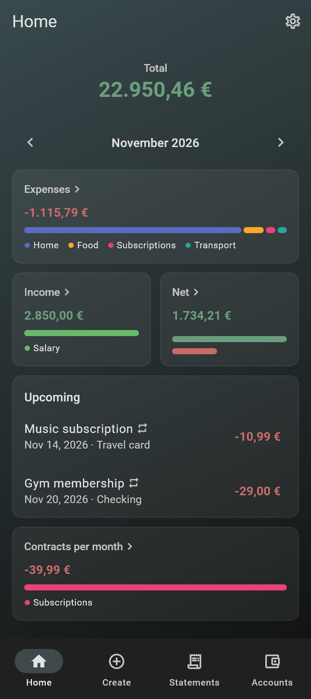
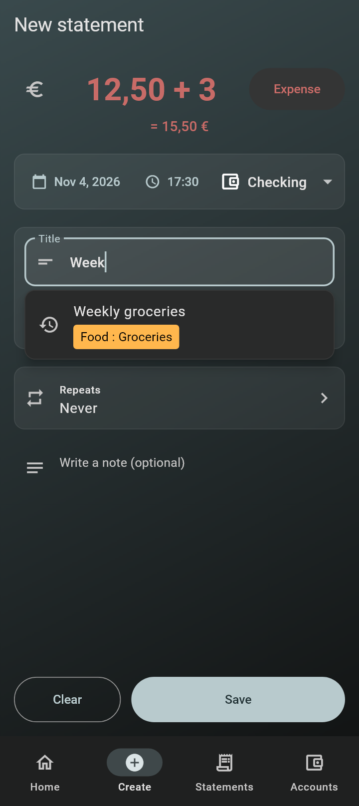
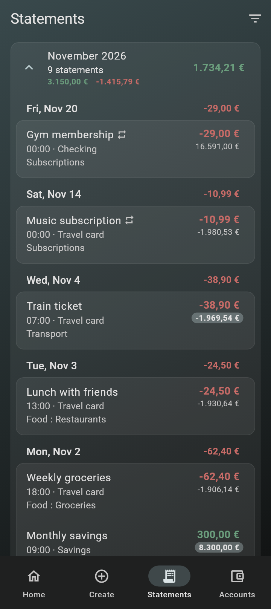
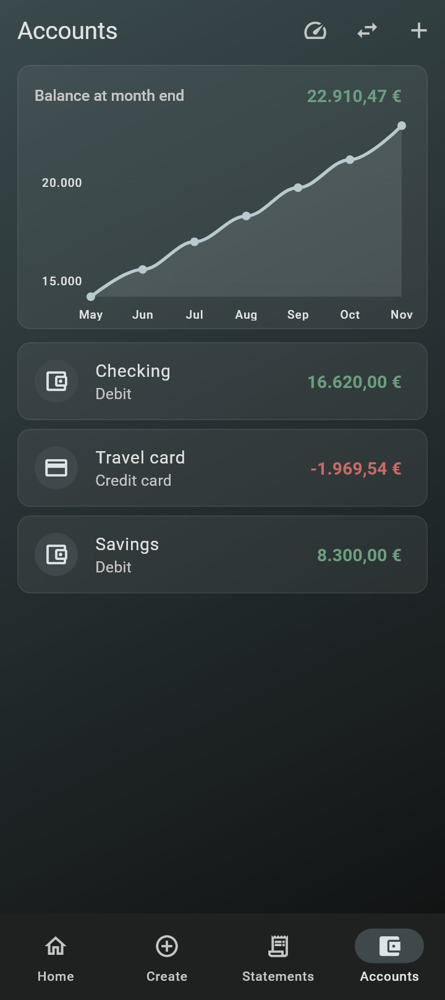

# Money Mind

A personal finance tracker for Android. Record your accounts and statements and see where your money goes. Everything stays in a local database on your device, with no account or server.

<p>
  
  
  
  
</p>

<sub>The screenshots show invented example data.</sub>

## Features

- **Accounts:** debit accounts and credit cards, with transfers between them and a shortcut to settle a card's billing period.
- **Statements:** type sums like `12,50 + 3` as the amount, and reuse an earlier statement's account and tags by picking its title from the suggestions.
- **Tags:** colored and nestable, so `Food : Groceries` also counts towards `Food`.
- **Recurring statements:** added automatically when they fall due, and listed as upcoming on Home.
- **Analysis:** spending and income by tag, monthly trends, the balance over time and what your contracts cost per month.
- **Your data:** back up and restore everything, export statements as CSV and import from MoneyWise.
- **App lock:** ask for your fingerprint or screen lock when the app opens.

## Install

Download the APK from the [latest release](https://github.com/Tag365/money_mind/releases/latest). To get updates automatically, add this repository's URL to [Obtainium](https://github.com/ImranR98/Obtainium).

## Development

Money Mind is built with [Flutter](https://flutter.dev) (CI uses 3.47.9) and stores its data in SQLite through [Drift](https://drift.simonbinder.eu).

```sh
flutter pub get
flutter run
flutter analyze
flutter test
flutter build apk --release
```

After changing the database tables, regenerate the Drift code and commit the result:

```sh
dart run build_runner build --delete-conflicting-outputs
```

Android is the primary target. See [CLAUDE.md](CLAUDE.md) for the architecture and the pull request workflow.
